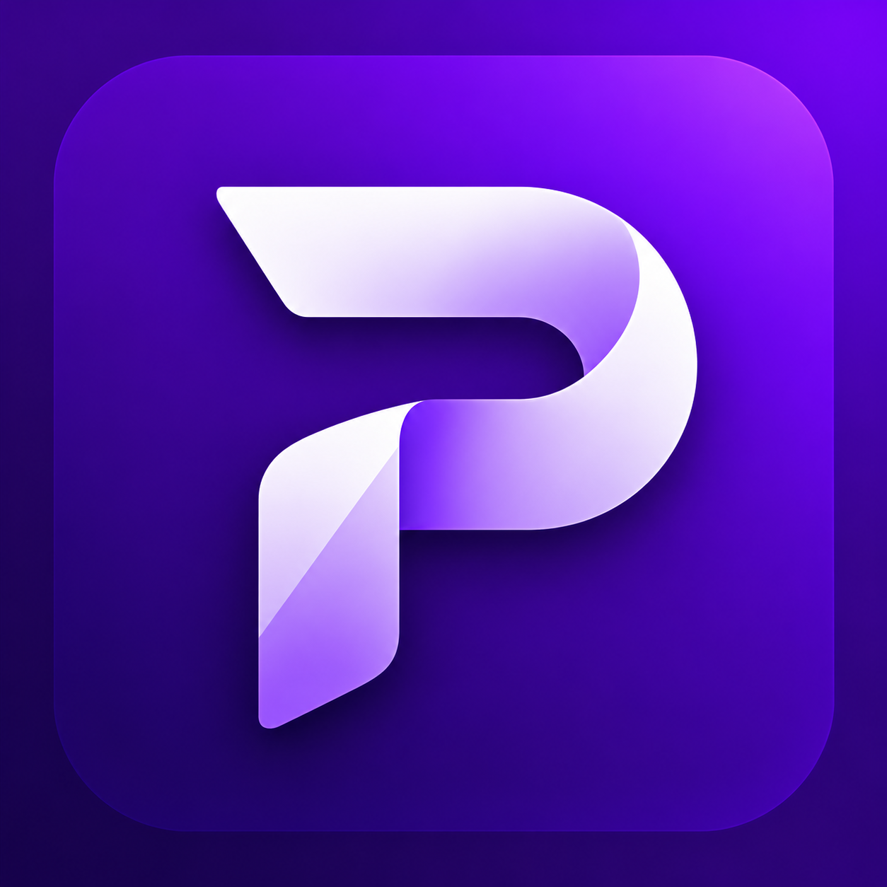
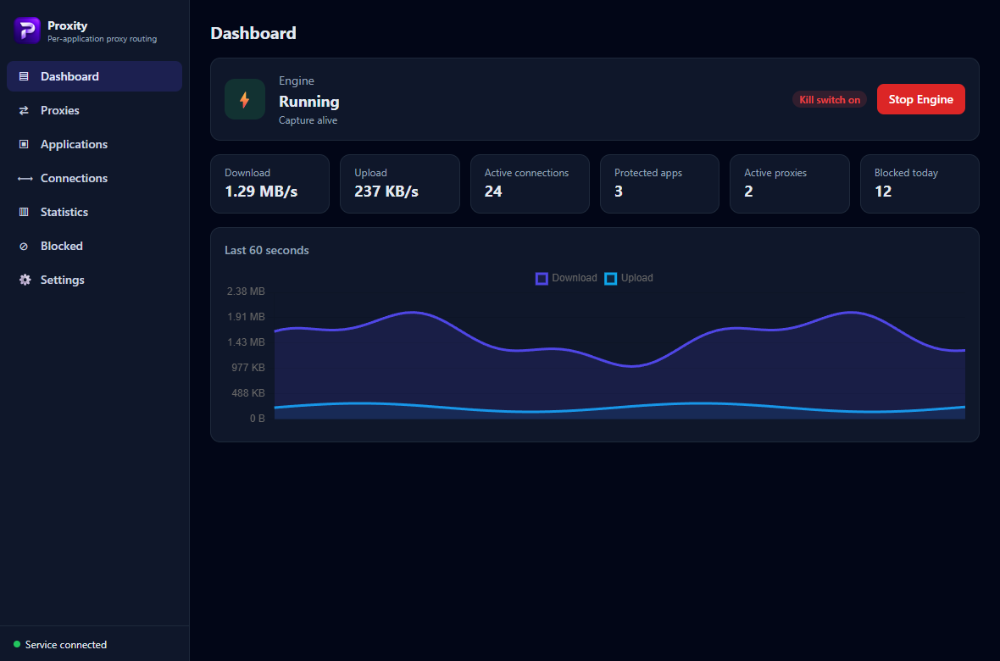
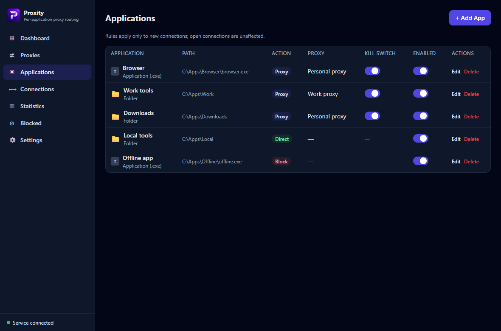
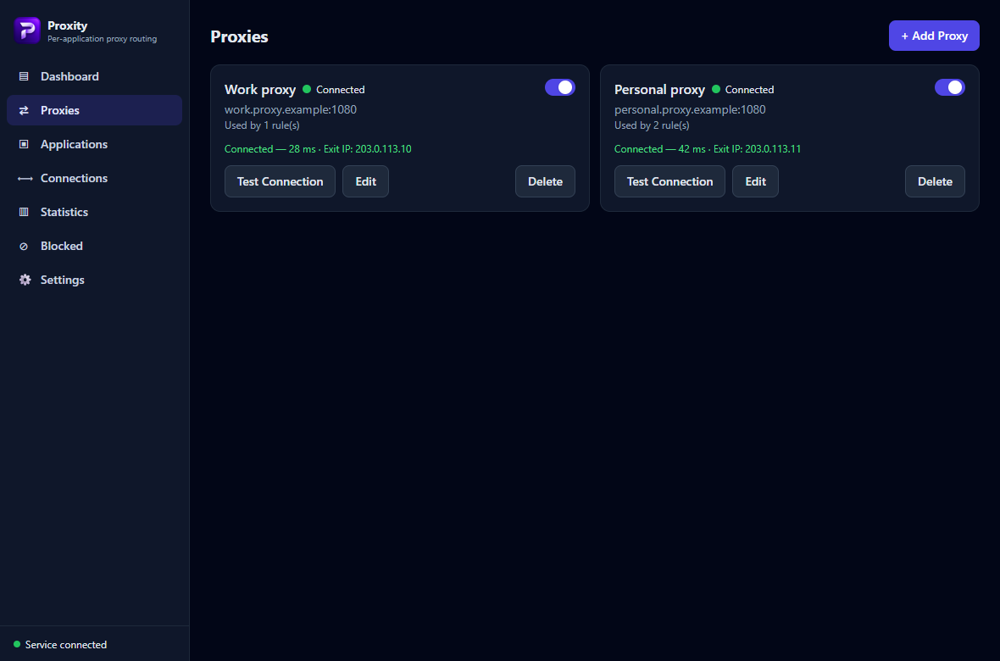
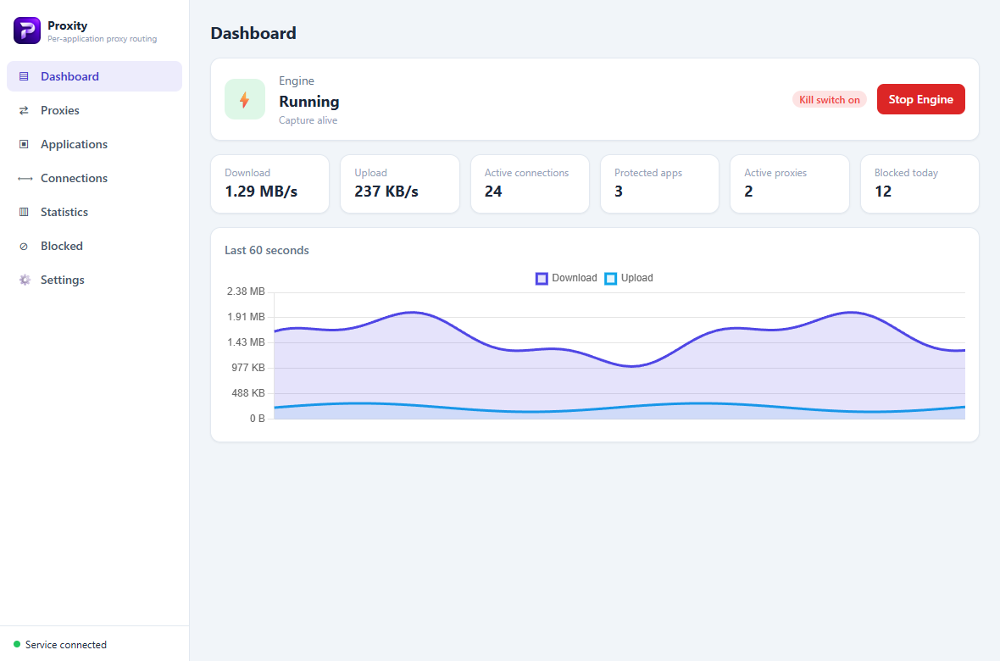

<div align="center">



# Proxity

### One Windows PC. A different route for every app.

Route your browser through one proxy, your work tools through another,<br />
and keep everything else on the connection you choose.

<p>
  
  
  <a href="LICENSE"></a>
  <a href="https://github.com/Glimor/proxity/actions/workflows/ci.yml"></a>
</p>

<a href="https://github.com/Glimor/proxity/releases"></a>
<a href="docs/user-guide.md"></a>

**Per-app rules · Multiple proxies · Kill switches · Live traffic insights**

[Why Proxity](#your-connections-your-call) · [Quick start](#from-install-to-your-first-rule) · [Screenshots](#see-your-network-at-a-glance) · [FAQ](#questions-before-you-install) · [Contribute](#built-in-the-open)

</div>

<picture>
  <source media="(prefers-color-scheme: dark)" srcset="docs/screenshots/dashboard.png" />
  <source media="(prefers-color-scheme: light)" srcset="docs/screenshots/dashboard-light.png" />
  
</picture>

<p align="center"><sub>The actual Proxity interface, shown with illustrative demo data. Light and dark themes included.</sub></p>

## Your connections, your call

You should be able to choose a route for an application without changing how every other application connects. Proxity gives you **Proxy**, **Direct**, and **Block** rules for individual executables or entire folders, with a dashboard that shows what is happening.

| On your PC | Your rule | The result |
| :--- | :--- | :--- |
| 🌐 **Browser** | Proxy → Personal proxy | New browser connections use your selected SOCKS5 profile. |
| 💼 **Work tools** | Proxy → Work proxy | A folder rule covers the tools you want on a separate route. |
| 🏠 **Local tools** | Direct | Those applications use their normal connection. |
| ⛔ **Offline app** | Block | Internet connections are blocked; LAN and loopback exemptions remain. |

**No system-wide proxy setting changes.** Rules apply to new connections, so restart an application after changing its route.

## More control. More visibility.

| | What you get |
| :--- | :--- |
| **🎯 Rules that fit your apps** | Select an executable, choose a running process, drag in an `.exe`, or cover a folder and its subfolders. |
| **🔀 Multiple SOCKS5 profiles** | Store several proxies with optional authentication. Test a profile and see its latency and exit IP before assigning it. |
| **🛡️ Configurable kill switches** | Protect individual proxy rules or enable a global kill switch. Persistent Windows Filtering Platform blocks keep configured protection in place when the engine stops. |
| **🔎 Optional Secure DNS** | Resolve through a local DNS forwarder and a selected proxy, with managed adapter DNS settings. |
| **📈 Traffic you can inspect** | Watch bandwidth, active connections, and blocked traffic. Explore per-app and per-proxy statistics, then export them as CSV. |
| **🌗 A window that gets out of the way** | Choose light, dark, or system theme. Close to the tray while the background service keeps routing. |

## From install to your first rule

**Bring a SOCKS5 proxy. Proxity handles the routing.**

1. **Install.** Download `Proxity-amd64-installer.exe` from [Releases](https://github.com/Glimor/proxity/releases) and run it. Setup installs the GUI, background service, and WinDivert files.
2. **Connect.** Add your proxy's host and port in the setup wizard. Enter credentials if needed, then test the connection.
3. **Choose your app.** Select an executable or folder and assign the proxy. Enable its kill switch if the app must not fall back to a direct connection. Restart the target app to open new connections.

The engine starts automatically with the service. Check **Dashboard → Engine** to see its state or explicitly start/stop it.

> **Before installing:** Windows 10/11 x64 and administrator access are required. The interface uses Microsoft WebView2; setup checks for its runtime. Current builds are unsigned, so Windows may display a SmartScreen prompt.

## See your network at a glance

### Rules you can read

Review the application, route, proxy, and protection state together. Keep individual apps separate, or use folder rules to manage a group.



### Proxies you can check

See which profiles are connected, how quickly they respond, and which exit IP they report. Test, edit, or disable a profile from its card.



<details>
<summary><strong>Prefer a lighter workspace? See the light theme.</strong></summary>



</details>

*All screenshots use demo endpoints and sample activity. They contain no real proxy credentials or personal connection records.*

## Know what is protected

Clear boundaries make routing easier to trust and verify:

- **TCP over SOCKS5.** Proxity does not relay UDP. Proxy rules block remote UDP while LAN and loopback exemptions remain available.
- **Protection follows your configuration.** Enable a kill switch for each proxy rule that must stay blocked when routing is unavailable. Global protection is a separate setting.
- **Secure DNS is optional.** Enable it when you want Proxity to manage adapter DNS through a proxy. An application's own DNS implementation can behave differently.
- **Passwords are encrypted at rest.** Stored proxy passwords use machine-scope Windows DPAPI. Plaintext password export is an explicit option; treat those files as secrets.

Read the [user guide](docs/user-guide.md) for rule priority, startup settings, Secure DNS, and troubleshooting. The [security policy](SECURITY.md) describes the privilege boundaries and private reporting process.

## Questions before you install

<details>
<summary><strong>Does Proxity provide a proxy server?</strong></summary>

No. Supply a SOCKS5 server you already have access to. Proxity routes selected applications through your saved profiles.

</details>

<details>
<summary><strong>Will it change the route of every application?</strong></summary>

You control that through rules and the default action. The default is Direct for unmatched traffic. Global kill-switch and Secure DNS settings can have wider effects, so review them separately.

</details>

<details>
<summary><strong>Does closing the window stop routing?</strong></summary>

No. Closing hides the window in the tray. **Quit Proxity** closes the GUI and tray, while the background service keeps running. Stop the engine explicitly from the Dashboard.

</details>

<details>
<summary><strong>Why an installer if the build also produces .exe files?</strong></summary>

The installer packages the components that must exist before it can be built:

| Build output | Purpose |
| :--- | :--- |
| `proxity.exe` | The window, settings UI, notifications, and tray. |
| `proxity-service.exe` | The background engine that routes traffic and manages protection. |
| `WinDivert.dll` / `WinDivert64.sys` | Packet capture and driver components used by the engine. |
| `Proxity-amd64-installer.exe` | Distributes those components together, checks WebView2, and installs/starts the service. |

**For normal installation, download the installer.** A standalone GUI executable is not a complete Proxity installation. Keeping the component binaries in `build/bin` also helps development and troubleshooting; their presence does not make the application portable.

</details>

<details>
<summary><strong>Can I use a ZIP instead of the installer?</strong></summary>

Yes, a ZIP distribution can contain the GUI, service binary, and both WinDivert
files. The installer is a convenient way to put those components in place and
register/start the service; it is not the only way to run Proxity. The GUI can
also request service installation with administrator consent.

If the service is already installed or the engine is running separately, opening
`proxity.exe` connects to it. On a fresh machine, opening the GUI alone does not
start traffic routing without an available engine.

The current design stores data outside the extracted folder and may register a
Windows service pointing to that folder. A ZIP is therefore a distribution
option, rather than a fully portable mode. Keep the service's registered folder
in place while using it; moving or deleting it can prevent the service from
starting. A fully portable mode would need its own startup, local-data, and
cleanup behavior.

</details>

<details>
<summary><strong>Where is my data, and what happens on uninstall?</strong></summary>

Service data and logs are stored in `%ProgramData%\Proxity`; GUI preferences and the notification-logo cache are in `%LocalAppData%\Proxity`.

Uninstalling removes the service, its WFP filters, and service data, and restores managed adapter DNS settings. **Export any proxy profiles you want to keep before uninstalling.**

</details>

## Built in the open

Proxity is built with **Go · Vue 3 · TypeScript · Wails**, with source available under GPL-3.0.

| I want to… | Start here |
| :--- | :--- |
| Configure or troubleshoot Proxity | [User guide](docs/user-guide.md) |
| Understand the engine and service | [Architecture](docs/architecture.md) |
| Build, test, or improve the project | [Contributing](CONTRIBUTING.md) · [Developer guide](docs/dev.md) |
| See what changed | [Changelog](CHANGELOG.md) |
| Report a reproducible bug | [GitHub Issues](https://github.com/Glimor/proxity/issues) |
| Report a security vulnerability privately | [Security policy](SECURITY.md) |

<details>
<summary><strong>Build from source</strong></summary>

Use the Go version in `go.mod`, Node.js **22.12+**, Wails CLI **v2.16.0**, and NSIS:

```powershell
powershell -ExecutionPolicy Bypass -File scripts/build.ps1 -Version 0.1.0
```

Output goes to `build/bin`, including the installer and the component binaries it packages. Use `-NoInstaller` for development builds that only need the binaries.

`build/` is ignored and recreated automatically. The canonical logo is in `assets/branding/`, Windows templates are in `packaging/windows/`, and the build implementation is in `scripts/`. Keep those source directories in Git.

See [the developer guide](docs/dev.md) for local development, tests, and screenshot generation.

</details>

## License & credits

Proxity is licensed under [GPL-3.0](LICENSE). [WinDivert](https://github.com/basil00/WinDivert) is distributed under its [bundled license](third_party/windivert/LICENSE). The WFP and WinDivert bindings include code adapted from the MIT-licensed WireGuard for Windows project; their NOTICE headers retain attribution.

<div align="center">

**Give every app a route you choose.**

[Download Proxity](https://github.com/Glimor/proxity/releases) · [Read the guide](docs/user-guide.md) · [Contribute](CONTRIBUTING.md)

</div>
