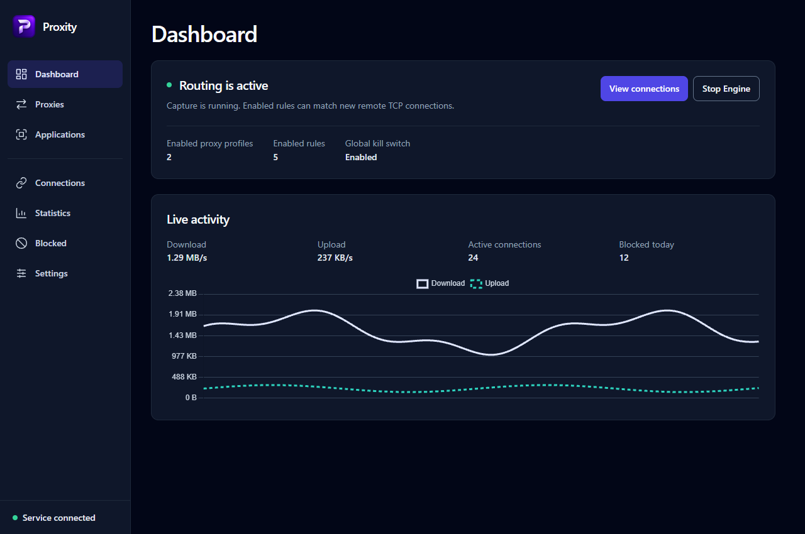
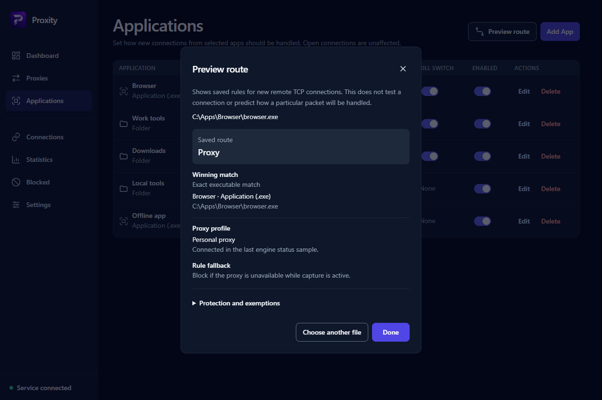
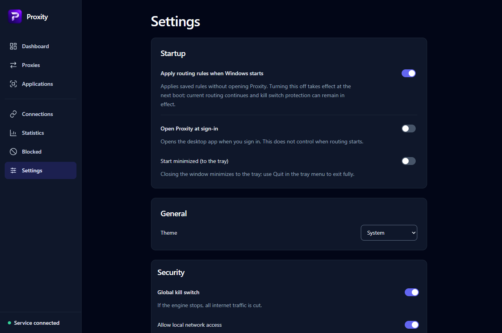

# Proxity User Guide

## Installation

1. Run `Proxity-amd64-installer.exe` and approve the UAC prompt. The installer
   copies `proxity.exe` (the GUI), `proxity-service.exe` (the background
   service), and the WinDivert driver files to
   `%ProgramFiles%\Proxity\Proxity`, then installs and starts the
   `ProxityEngine` service.
2. The first-run wizard helps you configure the app.
3. Check the service status on the Dashboard. If you see **Proxity service
   is unreachable**, follow the **Start service** or **Install service**
   prompt, as shown. Windows asks for administrator consent.

> A SmartScreen warning is expected because the builds are unsigned.

## Dashboard

Start with the routing status. **Routing is active** means capture can match
enabled rules for new remote TCP connections. **Routing is paused** means
capture is off, but kill switch protection may still apply. If you see
**Capture is unavailable**, the engine is running but can't match new
connections. Use **Stop Engine** before starting it again.

The suggested action depends on what's missing: **Add a proxy** if no proxy
profiles are enabled, **Set up application rules** if no rules are enabled,
or **Start Engine** if setup is ready and the engine is off. When routing is
active and setup is ready, **View connections** opens the connection list.
**Live activity** shows traffic rates, counts, and a bandwidth chart once
enough samples are available. **Last session** appears when routing is active
and a previous session is available.

The screenshots in this guide and the [README gallery](../README.md#see-your-network-at-a-glance)
show sample configuration, proxy status, and traffic, not live test results.

## Key concepts

| Concept | Meaning |
|---------|---------|
| **Profile** | An HTTP, HTTPS, SOCKS4 or SOCKS5 proxy with a type, host, port, and optional credentials. The password is encrypted with DPAPI and tied to the machine. |
| **Rule** | An exe or folder, an action (Proxy / Direct / Block), and an optional kill switch. Folder rules can include subfolders. |
| **Engine** | Uses WinDivert to match new outbound remote TCP connections against enabled rules. |
| **Kill switch** | Protection that can block traffic when routing is unavailable. The rule fallback and Windows firewall policy are separate; global protection is configured separately. |

## Proxy profiles

In the setup wizard or **Proxies → Add Proxy / Edit**, choose **Proxy type**,
then enter the host (without a URL scheme) and the provider's port. The card shows
the saved type. **Test Connection** uses that type, as do background health checks
and Secure DNS when this profile is selected.

- **HTTP**: CONNECT tunneling, with optional Basic username/password authentication.
- **HTTPS**: CONNECT over TLS to the proxy, with optional Basic authentication.
  Use a host matching a certificate trusted by Windows; certificate checks cannot
  be disabled in the UI.
- **SOCKS4**: optional **User ID**; the password field is hidden. Switching an
  existing profile to SOCKS4 clears its stored password. IPv4 is supported;
  names require SOCKS4a support on the server. IPv6 destinations are unsupported.
- **SOCKS5**: optional username/password, with IPv4, IPv6 and proxy-side name resolution.

All types relay TCP only. HTTP(S) servers must allow CONNECT to the destination
port. The connection test probes port 443; exit-IP lookup is best effort and may
be unavailable when the server disallows port 80. Secure DNS uses the configured
resolver port, which the proxy must also allow.

Existing profiles are automatically migrated to SOCKS5. Profile exports include
`protocol` (`http`, `https`, `socks4`, or `socks5`); older imports without it use
SOCKS5. Unknown types and SOCKS4 profiles containing passwords are rejected.

## Rules

- **Proxy**: matching TCP connections use the selected profile when available.
  If it's unavailable during active capture, the rule falls back to **Block**
  with its kill switch on or **Direct** with it off. Windows firewall protection
  for an exact executable can block remote UDP regardless of that setting.
- **Direct**: behaves like traffic without a matching rule and is useful for
  applications that should explicitly bypass proxies.
- **Block**: capture blocks matching new remote TCP connections. Separate
  firewall policy can also apply to exact executables.

Use **Applications → Add App** to set up a rule. Capture considers only
enabled rules. An exact executable match wins over any folder match. If
only folders match, the deepest matching folder wins. Higher priority breaks
ties between equally specific matches; if their priorities also tie, the
first in saved rule order wins. Folder rules don't add firewall protection
for individual executables.

### Preview a route

1. With the service connected, open **Applications → Preview route** and
   pick an `.exe`.
2. Read **Saved route** and **Winning match** to see what the saved rules say
   about new remote TCP connections for that file. For a Proxy rule,
   **Proxy profile** shows its name if the profile still exists and reports
   availability from saved settings and the last engine status sample.
   **Rule fallback** shows what the matching rule specifies if the proxy is
   unavailable while capture is active.
3. Expand **Protection and exemptions** to review separate Windows firewall
   policy for the exact executable, the global kill switch, and relevant
   exemptions. This shows saved policy, not proof that a firewall filter is
   installed or that a connection is allowed.

Preview doesn't run a live connection test, check a destination, save changes,
or affect open connections. If the engine is off or capture is unavailable,
the saved match and fallback are shown for reference and aren't applied by
capture. Global and exact-executable firewall protections can still apply.

If no enabled rule matches, capture currently passes traffic through directly,
even if **Default action for apps without a rule** is saved as **Block**.
Separate protections, such as the global kill switch or Secure DNS, may still
affect that traffic.

## Settings

### Startup

In **Settings → Startup**, use **Apply routing rules when Windows starts** to
choose when Windows launches the background service. Turning it on selects
**Automatic (Delayed Start)**. At the next boot, Windows starts the service
after a delay so it can load the saved rules and start the engine without
opening the desktop app. Turning it off selects **Manual**: the next boot
won't automatically start the service. This setting doesn't start, stop, or
uninstall the service now. Current routing is unchanged, and persistent
kill switch protection can remain in effect.

**Open Proxity at sign-in** is separate. It opens the desktop app when you
sign in and doesn't control when routing starts.

### Other settings

- **Global kill switch**: if the engine stops, internet access is blocked for
  the entire machine. LAN access can be allowed separately.
- **Secure DNS**: changes adapter DNS to 127.0.0.1. Queries are resolved
  through a proxy so plaintext DNS does not leave the machine. You can choose
  the upstream and the profile used for DNS.
- **Notifications**: alerts for blocked connections and proxy
  disconnections/reconnections.
- **Import/export**: profiles can be transferred as JSON. Including passwords
  is optional; store exported files securely.

## Window and tray

The engine starts automatically when the background service starts. Use
**Start Engine** or **Stop Engine** on the Dashboard when shown.
Closing the window hides it in the tray. Right-click the Proxity tray icon
for **Show Proxity** or **Quit Proxity**. Quitting closes the GUI and tray;
the background service keeps running.

## Uninstall

Use `uninstall.exe` or Windows Settings > Apps. The uninstaller:

- Runs `proxity-service.exe -uninstall`, stops and removes the service,
  removes all WFP filters and the provider, and restores adapter DNS settings.
- **Deletes `%ProgramData%\Proxity`** (the database, rules, profiles,
  statistics, and logs). Export profiles first if you want to keep them.

## Troubleshooting

- **Service unreachable**: follow **Start service** or **Install service** on
  the Dashboard. You can check `ProxityEngine` in `services.msc`.
- **An application is not using its proxy**: use **Preview route** to check the
  saved match. Verify that the rule path matches
  the exe's full path (for example, use the actual exe rather than an
  updater running under AppData). Route matching affects new remote TCP
  connections; restart the application to re-establish its connections.
- **Logs**: `%ProgramData%\Proxity\logs`. Set the log level to `debug` in
  Settings for more detail.
- **Blocked screen**: shows the live list of kill-switch blocks.
